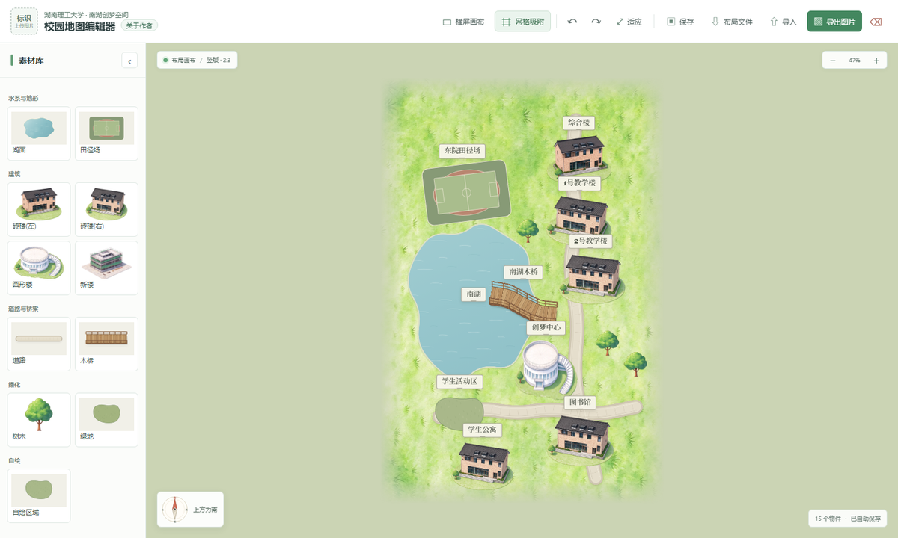

# createdream · 叠叠狐狸

湖南理工大学南湖创梦空间 · **校园地图编辑器**（纯静态，无需构建）

- 线上地址：<https://createdream.pages.dev>
- 仓库：<https://github.com/notbesttime/createdream>
- 作者主页：<https://nobesttime.pages.dev>



---

## 1. 它能做什么

| 功能 | 说明 |
| --- | --- |
| 多画布 | 顶部页签可新建/切换/关闭画布，右键页签重命名；每块画布都是**互相独立**的地图，最后一个画布不可关闭 |
| 素材库 | 湖面、道路、木桥、自绘区域（手绘轨迹）；砖楼(左/右)、圆形楼、新楼、树木、田径场、绿地（拖入或点击放置）；「自定义png贴图」可导入 PNG 当贴图 |
| 湖面合并 | 多块湖面重叠时自动合成一片水域，内部没有重复岸线，水纹连续 |
| 道路 / 桥梁合并 | 同类路径按并集渲染：接头无接缝、交叉不叠深；超出画布自动裁掉 |
| 桥梁立体感 | 大角度俯视：桥面厚度、竖直栏杆、前后遮挡与投影 |
| 图层 | 右下「图层」浮窗按 z 序排列（0 最底），拖动换层；道路/桥梁标注「地形层 / 顶层」 |
| 物件详情 | 选中物件后浮窗可改名、换素材、改尺寸/旋转、复制、上下移、删除；道路/桥梁可勾选「点击穿透」「渲染在建筑之上」 |
| 导出 PNG | 圆角地图卡片 + 云海背景 + 左上角圆形校徽 + 可编辑标题（默认「南湖创梦空间」）+ 左下角指南针 |
| 横竖版 | 一键切换；切换时等比适配，切回可精确还原，不会越切越小 |
| 存档 | 自动存浏览器 localStorage；也可导出/导入 JSON 布局，便于分享 |

## 2. 快速上手

1. 打开 <https://createdream.pages.dev>（或本地用任意静态服务器，见第 5 节）。
2. 左侧素材库点/拖即可放置；湖面、道路、木桥、自绘区域是「选中后在地图上按住拖动绘制」。
3. 点空白处拖动平移，滚轮缩放；点「适应」回到全图。
4. 选中物件后在右侧浮窗调参数；右下「图层」可点选/拖动换层。
5. 地图左上角的标题（默认「南湖创梦空间」）**直接点击就能改**，回车确认、Esc 取消。
6. 右上「导出图片」出 PNG；「布局文件」导出 JSON 存档。

## 3. 代码结构 / 想改哪里看这里

```
index.html            页面骨架（顶栏 / 画布页签 / 素材栏 / 画布 / 右侧浮窗 / 图层浮窗）
styles.css            全部样式（含云海背景、浮动面板、图层列表）
js/app.js             编辑器主逻辑（约 1000 行，见下表定位）
js/draw.js            内置素材的 Canvas 画法（DEFINITIONS + 各类 drawXxx）
js/paths.js           道路 / 桥梁的「合并渲染」（并集遮罩 + 分遍次绘制）
js/water.js           湖面的「合并渲染」（并集遮罩 + 连续水纹）
js/assets.js          位图缓存（同一文件只解码一次，全局共享）
js/default-layout.js  站点默认地图（新访客首次打开时使用）
js/vendor/konva.min.js Konva 12（本地文件，无外链）
assets/               位图素材（webp/png）与 favicon
tests/                离屏回归测试（Node + canvas，可选依赖）
```

### app.js 常用入口

| 想做什么 | 位置 |
| --- | --- |
| 增删素材类型、默认尺寸、绑定位图 | `js/draw.js` 顶部 `DEFINITIONS`（`src` 指向 assets 下的文件；`drawMode:true` 为手绘类；`upload:true` 为自定义 PNG） |
| 素材栏卡片生成 | `buildPalette()` |
| 物件创建与绘制 | `renderShape()` 里的 `sceneFunc`（画什么）、`hitFunc`（点击范围） |
| 图层顺序 | `syncZOrder()`（水面 → 道路 → 桥梁 → 物件 → 置顶道路 → 选框） |
| 图层面板 | `renderLayers()` / `dropLayer()` / `initPanelDrag()` |
| 画布页签（多地图） | `renderTabs()` / `switchMap()` / `addMap()` / `deleteMap()` / `renameMap()` / `bootMaps()` |
| 存档读写 | `copyData()`（序列化）、`restoreData()`（恢复）、`persist()`（写 localStorage） |
| 导出 PNG | `exportPNG()`：画布倍率 `scale`、地图占比 `mapScale`、云海背景 `paintCloudSea()`、校徽与标题 |
| 画布底图（草地/圆角/竖版旋转） | `boardCanvas()` |
| 天空/云海平铺 | `paintCloudSea()` + `assets/cloud-sea.webp` |
| 横竖版切换（可逆） | `orientationChange()` |
| 标题（可编辑） | `mapTitle` 变量、`updateTitlePos()`、`initTitleEditor` |

### 渲染模块接口

- `MapAssets`（js/assets.js）：`load(src)`、`loadAll(list)`、`get(src)`、`ready(src)`、`subscribe(src, fn)`。同一路径只解码一张位图，所有副本共享。
- `MapWater`（js/water.js）：`createRenderer().render(w, h, lakes)` → 返回画布；`lakes` 为 `[{x,y,w,h,rotation,pathPoints,pathBaseW,pathBaseH}]`。
- `MapPaths`（js/paths.js）：`renderRoads(w,h,list)`、`renderBridges(w,h,list)`；`list` 为 `[{points:[{x,y}...], thickness}]`。
- `MapArt`（js/draw.js）：`definitions`、`draw[type](ctx,w,h,item)`、`lakePath(ctx,w,h,item)`、`thumbnail(type)`、`roundRect`、`pathHelpers`。

### 布局 JSON 结构

```json
{
  "orientation": "portrait | landscape",
  "snapEnabled": true,
  "logoData": "assets/school-logo.png 或 data:image/png;base64,...",
  "title": "南湖创梦空间",
  "items": [
    { "id": "item-xxx", "type": "brick|round|tree|road|lake|...", "x": 0, "y": 0, "w": 100,
      "h": 80, "rotation": 0, "name": "", "showName": true,
      "pathPoints": [{ "x": 0, "y": 0 }], "pathBaseW": 100, "pathBaseH": 80, "pathThickness": 42,
      "noHit": false, "overItems": false, "imageData": "" }
  ]
}
```

> 多画布存档键：`ddhx-campus-maps-v2`（`{maps:[{id,name,data}], activeId}`）；旧版单画布键 `ddhx-campus-map-v1` 会自动迁移。

## 4. 常见修改示例

- **换默认地图**：编辑器里调好后点「布局文件」导出，覆盖 `js/default-layout.js` 里的 `window.DEFAULT_LAYOUT`（只影响没有本地存档的新访客）。
- **换/加建筑贴图**：把图片处理成透明底 WebP 放进 `assets/`，在 `DEFINITIONS` 里加 `{type, label, w, h, src:"assets/xxx.webp"}`，无需改渲染代码。
- **改导出尺寸/留白**：`exportPNG()` 里的 `scale`（当前 1.6）与 `mapScale`（当前 0.90）。
- **改标题默认值**：`mapTitle` 初始值；页面上直接点标题也能改。

## 5. 本地运行 / 开发

纯静态，任意静态服务器即可。

```bash
# 方式一：双击 启动预览.cmd（Windows，自动起服务器并打开浏览器）
# 方式二：
python -m http.server 8080
# 打开 http://127.0.0.1:8080/
```

> 直接用 `file://` 双击也能编辑，但浏览器跨源限制会**禁止导出 PNG**；导出请用服务器方式或线上地址。

回归测试（Node + 可选 `canvas` 模块，仅开发用）：

```bash
node tests/render-regression.cjs     /path/to/node_modules/canvas
node tests/path-regression.cjs       /path/to/node_modules/canvas
node tests/asset-regression.cjs      /path/to/node_modules/canvas
node tests/app-regression.cjs        /path/to/node_modules/canvas
node tests/resilience-regression.cjs /path/to/node_modules/canvas
node tests/default-export.cjs        /path/to/node_modules/canvas
```

产物写到 `tests/artifacts/`（已 gitignore）；基准图在 `tests/fixtures/`。

## 6. 部署

线上用 **Cloudflare Pages**，项目名 `createdream`。

- 自动部署：推送到 `main` 由 `.github/workflows/deploy-pages.yml` 构建 `dist/` 并发布；需在仓库 Secrets 配 `CLOUDFLARE_API_TOKEN`（Account · Cloudflare Pages · Edit）。
- 手动发布：`npx wrangler@3 pages deploy dist --project-name createdream --branch main`（需要本机 `wrangler login`）。

## 7. 许可与素材

- 代码可自由学习、修改、二次分发。
- `assets/` 下的建筑/树木位图与校徽为湖南理工大学相关素材，仅供校园地图用途；云海与草地为程序化生成。
